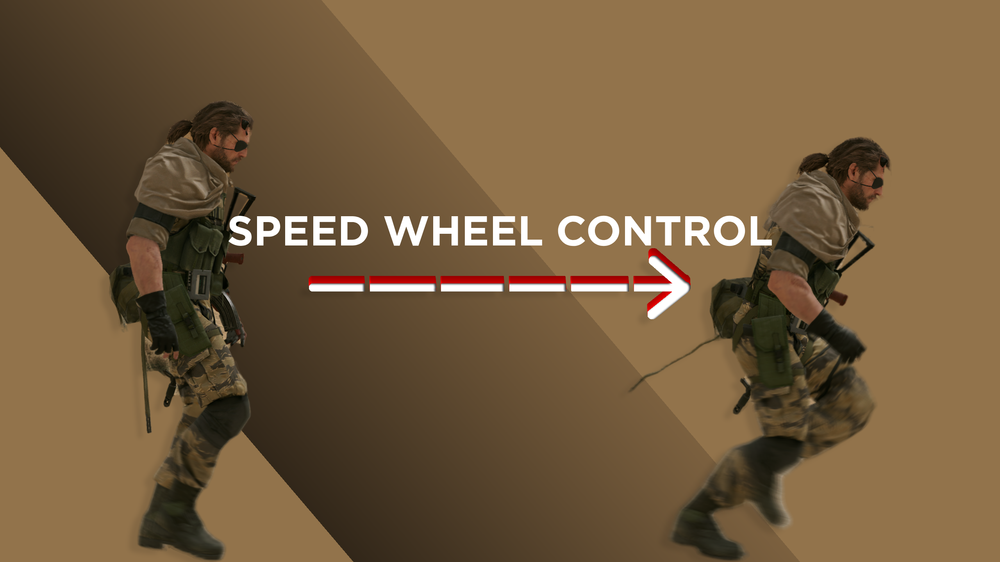

<h1 align="center">
  
</h1>

Dynamic on-foot movement speed for **Metal Gear Solid V: The Phantom Pain** (1.0.15.4 EN) for M+KB players. Scroll the mouse wheel to pick a speed, like Splinter Cell did it back in the day.

- **Wheel up** = faster, **wheel down** = slower.

- **Walk key** = reset to the default speed. The plugin reads the game's own walk
  state (`Work + 0x2B0` bit `0x100`), so it follows whatever key the in-game
  binding uses. Behaviour is a knob: *Reset + walk* (default), *Reset, no walk*,
  *Off*.

- **Knobs live in Infinite Heaven's menu** (F3 → *Speed Wheel Control*).

## Requirements

- MGSV:TPP 1.0.15.4 (Steam, EN)
- [IHHook](https://github.com/kapuragu/IHHook) with `enable_dll_loader=true` in `ihhook_config.lua`
- [Infinite Heaven](https://www.nexusmods.com/metalgearsolidvtpp/mods/45)

## In-game knobs (F3 → Speed Wheel Control)

| Knob | Meaning |
|---|---|
| Speed system | master switch (same as F7) |
| Wheel step | levels moved per wheel notch (1–3) |
| Transition smoothing | gait blend time when changing level (0–0.5 s) |
| Invert wheel | wheel up = slower |
| Walk key | `Reset + walk` keeps the native walk pace, `Reset, no walk` uses the key purely as a reset, `Off` disables the reset |

## Config (`SpeedWheel.ini`)

Values here are defaults. Once Infinite Heaven writes `SpeedWheel.runtime`, the menu values take over.

| Key | Default | Meaning |
|---|---|---|
| `enabled` | `1` | master switch |
| `hotkeyEnabled` | `1` | F7 = toggle, F8 = reset to top speed |
| `levels` | `0.10,0.23,...,1.00` | target move-speed rate per notch; `1.0` = vanilla run |
| `defaultLevel` | `7` | index of the starting notch (7 = top speed) |
| `walkKey` | `2` | walk key: `0` off (native walk), `1` reset + no walk, `2` reset + walk |
| `invertWheel` | `0` | `1` = wheel up slows down |
| `wheelStep` | `1` | levels moved per wheel notch (1–3) |
| `smoothSeconds` | `0.12` | gait transition smoothing |
| `forceMin` / `forceMax` | `0` | `0` = read the game's own force limits (0.1 / 0.95) |
| `playerIndex` | `-1` | `-1` = auto-detect the local player; force a value only if the log shows the wrong index |
| `requireForeground` | `1` | ignore the wheel when the game is not focused |
| `requireCursorHidden` | `1` | ignore the wheel while a menu shows the cursor |
| `logLevelChanges` | `1` | one log line per notch |
| `logWheel` | `1` | raw wheel deltas and gate decisions |
| `logEveryFrame` | `0` | per-frame force log; debug only, very noisy |
| `heartbeatSeconds` | `5` | periodic state line; `0` disables |

## Build

Requires CMake ≥ 3.20 and MSVC (VS 2022/2026, x64). MinHook is a git submodule and is initialized by the build script.

```powershell
.\build.ps1            # configure + build
.\build.ps1 -Deploy    # build, then copy the DLL and the IH module into the game
.\bundle.ps1           # build + assemble bundle/MGS_TPP (plugins/, mod/modules/)
.\bundle.ps1 -Deploy   # build, assemble the bundle, then copy it into the game
```

Output: `build/Release/SpeedWheel.dll` and `lua/SpeedWheel_Core.lua`.

## Notes

- The wheel is a single shared per-frame delta in `PadImpl+0x48C`. The plugin
  drops notches the game used for zoom: the scope/binocular path is detected by
  its player status bit, the iDroid map by IH's `inIdroid`. Aiming a weapon keeps
  the wheel, so speed still changes while moving and aiming.
- The walk key resets to `defaultLevel` (top speed by default). It is not a
  configured hotkey: the game's own walk flag is read every frame, so rebinding
  the key in-game works without touching the ini.
- `walkKey` picks what the key does: `0` = native walk only, `1` = reset and no
  walking (the plugin masks the walk clamp in `GetMoveForceLimit` for that
  frame), `2` = reset and native walk (default). Same setting in F3 →
  *Speed Wheel Control*.
- Single-player only. Do not use on MGO/FOB — client-side speed changes are not replicated and may be treated as cheating.
- Log: `MGS_TPP/plugins/SpeedWheel.log`.
- Changelog: [`CHANGELOG.md`](CHANGELOG.md).
- Reverse-engineering notes: [`docs/MGSV_MovementSpeed_RE.md`](docs/MGSV_MovementSpeed_RE.md).
